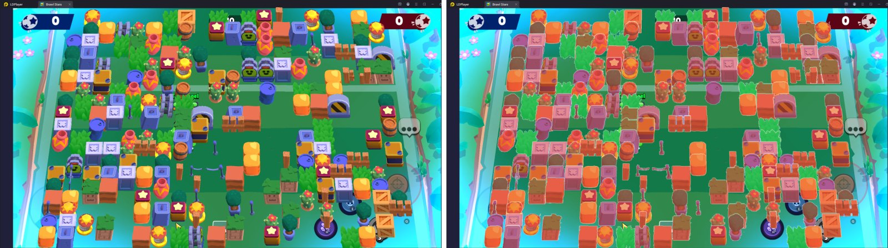

# Brawl Map Segmentation

Synthetic training data and a YOLO11 segmentation model that finds **walls** and **bushes** on Brawl Stars maps.


<sub>Left: a synthetic map from the generator. Right: the labels it writes automatically (red = wall, green = bush).</sub>

## Why

Labelling game screenshots by hand is slow and doesn't scale. This pipeline makes its own training data instead: random and real map layouts are rendered onto gameplay backgrounds together with pixel-accurate labels, so a model can be trained on thousands of images with no manual annotation.

## My part

I started from part of the PylaAI trainer, improved it, and used it to train and export my own YOLO11 segmentation model for walls and bushes.

## How it works

| Step | What happens | Code |
|---|---|---|
| 1. Generate maps | Builds tile grids from random layouts or real map data, picks the right connected-wall variants, and renders them onto full-HD gameplay backgrounds with the game's perspective tilt. Images are saved at 640×640 for training. | `map_generator/` |
| 2. Add distractors | Pastes fake characters (with health bars, ammo bars and random usernames) and goal posts on top. They are not cut out of the masks, so the model learns to see walls and bushes behind characters. | `fake_brawler_generator/` |
| 3. Write labels | Draws every tile into an instance-ID map with a Numba-compiled kernel, then turns each instance into a YOLO polygon label (`wall` or `bush`) using OpenCV contours. Maps are generated in parallel across CPU cores. | `map_generator/generate_mini_maps.py` |
| 4. Split | 80/20 train/validation split. | `dataset_preparation_2.py` |
| 5. Train and export | Fine-tunes YOLO11n-seg with game-friendly augmentation (no rotation or vertical flips, HSV jitter, mosaic) and early stopping, then exports the model to ONNX. | `map_generator/yolo_training.py` |
| 6. Inference | Runs the model on real screenshots: with Ultralytics, or with ONNX Runtime using CUDA, DirectML or CPU. | `model_tester_pt.py`, `model_tester_onnx.py` |

## Run it

```bash
pip install -r requirements.txt

python main_map_generator.py    # steps 1-3: synthetic maps + labels in map_generator/output/
python main_model_training.py   # steps 4-5: split into dataset/, train YOLO11n-seg, export to ONNX
python model_tester_pt.py       # step 6: visualise predictions (set the model path at the top first)
```

- Generation settings (number of maps, backgrounds, tile probabilities) live in `map_generator/config.json`.
- Check that `map_generator/data.yaml` points at your `dataset/` folder before training.
- The character cutouts used as distractors (`fake_brawler_generator/skin_seg_3/`) are not included; without them the generator skips characters.
- Developed on Windows with Python 3.11 and an NVIDIA GPU (`device='0'`).

## Tech

Python · Ultralytics YOLO11 (PyTorch) · OpenCV · NumPy · Numba · Pillow · ONNX Runtime

## Credits

This project builds on the wall-detection trainer from the [PylaAI](https://github.com/PylaAI/PylaAI) project. Credit to the PylaAI developers for the original tools and the background screenshots.

Brawl Stars and its artwork are © Supercell. This is a non-commercial learning project and is not affiliated with or endorsed by Supercell.
